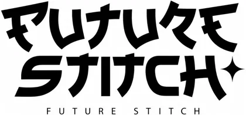
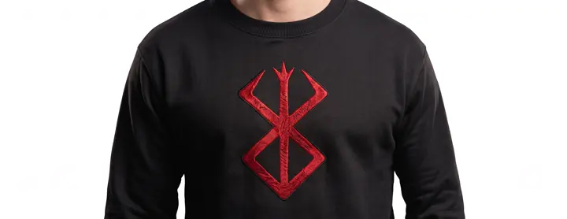
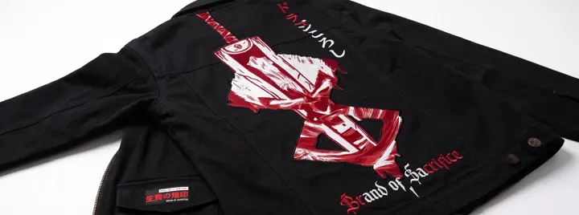
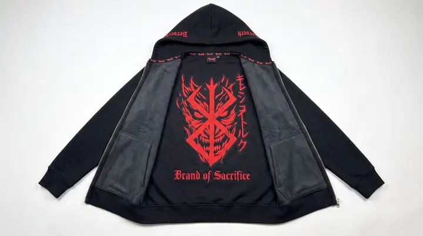
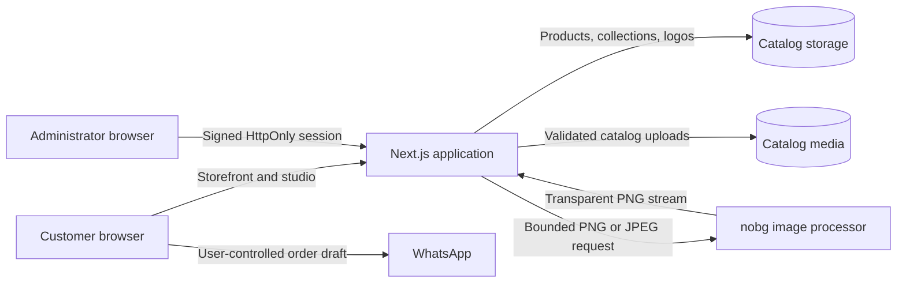

<p align="center">
  
</p>

<h1 align="center">Future Stitch</h1>

<p align="center">
  Anime-inspired apparel commerce, collection management, and a live front/back embroidery preview studio.
</p>

<p align="center">
  <a href="https://github.com/mohoamerakram-tech/berserk-jacket/actions/workflows/ci.yml">
    
  </a>
  
  
  
</p>

<p align="center">
  
  
  
  
</p>

<p align="center">
  <strong>Status:</strong> active student development and organization review. The application is not yet approved for production orders or storage of real customer personal data.
</p>

---

## Product preview

<table>
  <tr>
    <td width="33%" align="center">
      
      <br><strong>Constructed products</strong>
      <br>Inventory, size availability, imagery, and collection routing.
    </td>
    <td width="33%" align="center">
      
      <br><strong>Preset studio</strong>
      <br>Collection-filtered motifs with independent front and back layouts.
    </td>
    <td width="33%" align="center">
      
      <br><strong>Bespoke import</strong>
      <br>Background removal, placement, scale, rotation, and order preview.
    </td>
  </tr>
</table>

## Platform at a glance

| Surface | Current capability | Delivery state |
| --- | --- | --- |
| Home and collections | Manga-inspired discovery, active collections, upcoming releases | Implemented |
| Existing products | Product gallery, size inventory, sold-out states, cart | Implemented |
| Preset studio | Collection-specific embroidery motifs, front/back editing | Implemented |
| Bespoke studio | One upload per side, background removal, drag, scale, rotation | Implemented |
| Checkout | Product and preview summaries with customer-controlled WhatsApp handoff | Development flow |
| Admin | Single-admin collection, product, inventory, and logo management | Development baseline |
| Production persistence | Supabase REST catalog and public catalog-media storage | Prepared, deployment pending |
| Security program | CI, dependency auditing, ownership rules, staged release gates | Active roadmap |

## Customer journey

1. Choose an anime collection.
2. Buy an existing product, customize a preset motif, or import original artwork.
3. Configure the front and back independently.
4. Select the garment size and review the complete order.
5. Open a prepared WhatsApp draft and decide whether to send it.

The current WhatsApp handoff does not create a durable server-side order, prove message delivery, confirm payment, or reserve stock.

## Architecture



Development uses ignored local JSON and upload directories. The planned production data path uses server-only Supabase credentials. Customer artwork crosses to the external background-removal provider only when processing is requested.

Read the full [architecture and trust-boundary documentation](docs/ARCHITECTURE.md).

## Repository structure

```text
app/
  admin/              Protected catalog interface
  api/admin/          Authenticated catalog mutations
  api/remove-bg/      Validated background-removal proxy
  checkout/           Product and bespoke order review
  collection/         Collection discovery and routing
  components/studio/  Preview editor components
lib/
  admin/              Session and credential verification
  catalog/            Storage abstraction and public filtering
  checkout/           Order snapshots and WhatsApp formatting
  studio/             Motifs, garment options, and preview state
supabase/              Production catalog schema
tests/                 API boundary and failure-mode coverage
docs/                  Architecture, operations, and security program
.github/               CI, Dependabot, CODEOWNERS, and review templates
```

## Local development

### Requirements

- Node.js 24 or newer
- npm and the committed `package-lock.json`

### Installation

```sh
git clone https://github.com/mohoamerakram-tech/berserk-jacket.git
cd berserk-jacket
npm ci
```

Create a local environment file from the sanitized template.

```powershell
Copy-Item .env.example .env.local
```

```sh
cp .env.example .env.local
```

Start the application.

```sh
npm run dev
```

Open <http://localhost:3000>. Never commit `.env.local`, real credentials, customer uploads, database exports, or order data.

## Development commands

| Command | Purpose |
| --- | --- |
| `npm run dev` | Start the local Turbopack development server |
| `npm run lint` | Run the Next.js ESLint rules |
| `npm run typecheck` | Validate TypeScript without emitting files |
| `npm test` | Run the background-removal API tests |
| `npm run audit:prod` | Fail on known high-severity production dependency findings |
| `npm run build` | Produce and validate the production application |
| `npm run check` | Run the complete repository quality gate |

GitHub Actions runs the same quality gate on pushes and pull requests to `main`. Dependabot checks npm and GitHub Actions dependencies every week.

## Security trajectory

| Milestone | Objective | Major remaining work |
| --- | --- | --- |
| Development baseline | Safe collaboration and reproducible validation | Completed in this repository branch |
| Organization review | Controlled ownership and protected merges | Ruleset, CodeQL, secret scanning, asset register |
| Preview deployment | Public testing without real customer data | Shared rate limits, monitoring, CSP, backup validation |
| Order readiness | Safe handling of real orders and customer details | MFA, durable orders, audit trail, retention rules, independent review |
| Ongoing operations | Maintain and prove the security posture | Patch targets, restore drills, access reviews, SBOM and provenance |

The complete plan, exit criteria, current limitations, and risk-acceptance rules are maintained in the [security roadmap](docs/SECURITY_ROADMAP.md).

Security-sensitive behavior already implemented includes:

- Scrypt admin password verification with constant-time comparison
- Signed, expiring, HttpOnly, SameSite=Strict admin cookies
- Same-origin checks for administrator mutations
- Upload size, MIME, and file-signature validation
- Bounded external processing requests and upstream timeouts
- Baseline browser security headers
- Read-only CI permissions and immutable GitHub Action pins
- Lockfile installs, weekly dependency updates, and production auditing

Report suspected vulnerabilities privately according to [SECURITY.md](SECURITY.md). Do not put credentials, exploit details, customer artwork, phone numbers, or addresses in a public issue.

## Documentation index

| Document | Audience | Purpose |
| --- | --- | --- |
| [Architecture](docs/ARCHITECTURE.md) | Engineers and reviewers | Components, data lifecycle, and trust boundaries |
| [Development and operations](docs/OPERATIONS.md) | Developers and operators | Environment variables, storage modes, validation, and deployment gate |
| [Security roadmap](docs/SECURITY_ROADMAP.md) | Maintainers and organizations | Security milestones, risks, and release criteria |
| [Security policy](SECURITY.md) | Security researchers | Private vulnerability reporting and scope priorities |
| [Contributing](CONTRIBUTING.md) | Contributors | Branch, review, validation, and secure-engineering rules |

## Project boundaries

- nobg is an external artwork processor. Its privacy terms, quota, and availability require production review.
- Catalog media can be public; customer artwork and order data must not be placed in the public media bucket.
- The current process-local rate limits are a development control, not a scaled production defense.
- The custom admin system does not yet provide MFA, central revocation, or a durable audit trail.
- Media licensing, privacy requirements, consumer obligations, and data retention need formal review before commercial launch.

## Licensing and artwork

No open-source license has been selected. Anime names, logos, artwork, and other third-party assets remain the property of their respective owners. This student prototype does not claim affiliation or commercial licensing. Record the source, owner, license, and allowed use of every production asset before launch.
